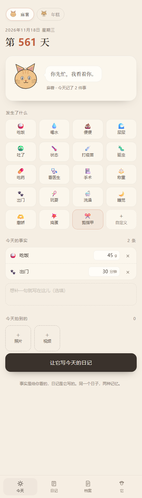

# 它眼里的世界

一个只记事实、让它自己写日记的宠物记录 App。

你每天点几下：吃了多少、便便什么样、出门多久、有没有吐。
剩下的交给它——它用第一人称，把这一天写成一篇日记。

日子久了，你就有它的一生。



---

## 出处 / 关于

- 作者：[@wz1995haha](https://github.com/wz1995haha)
- 项目地址：https://github.com/wz1995haha/its-world
- 在线试用（手机上也能开，可直接加到桌面）：https://wz1995haha.github.io/its-world/
- 许可：MIT（见 [LICENSE](LICENSE)），可自由使用、修改、再发布
- 制作方式：这个小项目的设计、文案、插画和代码，是和 AI 编程助手
  （DeepSeek Harness）一起反复迭代出来的——从「记录会反过来影响一个活物」这个想法开始，
  一路做到品种头像、主题、档案和小程序版
- 如果你改完再发布，麻烦保留这条出处和 LICENSE，让下一个人也知道它从哪来

**它不联网、不上传任何数据**：所有记录存在你自己的浏览器（IndexedDB / localStorage）里。
换设备请用「它」页的「导出备份 / 导入」。

---

## 打开

**双击 `dist/index.html` 就能用。** 单文件、离线、不需要联网，也不需要注册。

想在手机上用：把 `dist/index.html` 发到手机（微信/隔空投送都行），用浏览器打开，然后「添加到主屏幕」。

本地开发预览：

```bash
node serve.mjs        # http://127.0.0.1:5188
```

改了源码之后：

```bash
node build.mjs        # 把 src/* 内联成 dist/index.html
node tools/test.mjs   # 逻辑冒烟测试（74 项）
node tools/preview.mjs # 在终端里看看它今天会怎么写
```

---

## 发给别人用

三个选择，按「要不要多设备同步」来分：

| 做法 | 要部署吗 | 要登录吗 | 数据在哪 | 适合 |
|---|---|---|---|---|
| 把 `dist/index.html` 发给他 | 不用 | 不用 | 他自己设备的 IndexedDB | 朋友试玩、自己用 |
| 传到静态托管，发链接 | 要（GitHub Pages / Vercel / 对象存储都行） | 不用 | 还是各自的设备 | 想发一个链接而不是文件 |
| 加后端账号 + 数据库 | 要 | 要 | 服务器 | 换手机不丢、多设备同步 |

前两种情况下**不存在「串数据」的问题**：每个人的记录都在自己的浏览器里，
根本不会上传，也没法互相看见。代价是换设备 / 清缓存就没了，
所以要靠「它」页的「导出备份 / 导入」搬。

第三种才需要登录：谁来用、数据归谁，都得由服务器记。

## 功能

| 页面 | 做什么 |
| --- | --- |
| 今天 | 17 种内置事件 + 自己加的事件（可带数字、可改），写一句备注，传照片/视频，然后「让它写今天的日记」 |
| 日记 | 按月份排的日记本，一眼看到它写过的每一篇 |
| 档案 | 出生 / 到家 / 品种 / 体重；按年份排的重要节点（手术、绝育、疫苗、洗澡……）；体重走势 |
| 一篇 | 正文 + 当天的照片视频 + 「那天的事实」可展开 + 重写 / 存成图片 / 删掉 |
| 它 | 它的简介、陪伴天数、记录天数、篇数、资料、家里的其他成员、导入导出 |

- 改过事实之后，旧日记会标成「当时的版本」，而不是被悄悄替换 —— 事实会变，它记住的那天不会。
- 「存成图片」会生成一张 1080×1440 的分享卡片。
- 数据存在浏览器 localStorage 里，不上传。换设备前用「导出备份」。
- 首次打开可以点「先看看一只叫麻薯的猫的日记」，会灌入两只宠物（傲娇猫麻薯 + 黏人柴犬年糕）的示例。

## 照片和视频

在「今天」页下面点「＋ 照片 / ＋ 视频」，可以多选。点缩略图看大图，右上角 × 删掉。

- 照片会压到最长边 1800、JPEG 0.86（10MB 的原图通常变成几百 KB）
- 视频原样保存，另外抽一张封面图当缩略图；单个上限 500MB。抽不到封面也能存（手机上 HEVC 的 .mov 就是这样），不会整条传失败
- 字节存在 **IndexedDB**（localStorage 装不下），元数据仍在日记数据里；`#/today` 每次渲染时把 blob 贴回 ``，用完就 revoke
- 有照片/视频的那天，它会多写一句「你蹲下来，把那个小方块凑得很近……」这种话
- 备份（导出 JSON）**只含文字**，不带图片视频 —— 它们留在原设备

## 多只宠物

在「它」页面往下拉，有「家里的 N 只」：点一只就切过去，下面可以「＋ 再添一只」。

- 每只宠物有自己的名字、猫狗、**品种**、性格、**一句话简介**（显示在它的页面名字下面）、生日、到家日
- 记录、日记、本子、体重、统计全部按宠物分开 —— 麻薯的本子里不会混进年糕的日记
- 「今天」「日记本」页顶部有一排切换按钮；只有一只宠物时不显示
- 每只宠物的文案去重历史是独立的，所以两只宠物不会写出互相撞的句子
- 旧版本（单只宠物）的数据打开时会自动迁移，不用手动处理

## 品种、性格、自己的事件

**品种**：选猫或狗之后会出一排常用品种（猫 11 种、狗 15 种）。它不是只存个名字 ——
头像会真的跟着变：毛色、花纹（狸花条纹 / 奶牛斑 / 三花 / 重点色口罩）、耳朵形状
（立耳 / 垂耳 / 半立 / 长毛垂耳 / 圆毛球）、口鼻（柴犬的白口罩、哈士奇的灰眼罩、
边牧的白鼻梁）、白眉毛、下巴那一撮毛、雪纳瑞的白胡子和浓眉、西施的红蝴蝶结，
连眼睛颜色都按品种画。改成「黑猫」之后，家里那张脸就是黑的了。

狗：柴犬、柯基、金毛、拉布拉多、泰迪、边牧、哈士奇、萨摩耶、比熊、马尔济斯、
西施、西高地、雪纳瑞、博美、中华田园犬。

**性格**：除了「傲娇 / 黏人 / 高冷 / 贪吃 / 好奇」，最后还有一个「自己写」，
填什么它就按什么演 —— 正文里会直接引用你写的话（「你写我是个「嘴硬心软」的家伙。我承认一半。」）。

**自己的事件**：「发生了什么」最右边有「＋ 自定义」，可以给事件起名字（8 个字以内）、
配一个表情，加完就永久留在这排按钮里，点一下记一条。
比如「刷牙 🪥」「剪指甲 ✂️」「喂化毛膏 🧴」。

**健康档案**：「档案」页会把这些事单独按时间倒序列出来 —— 洗澡、看病、打疫苗、驱虫、吃药、
手术（绝育 / 其他）、吐了，每条带「N 天前」。用户最想记住的其实就是这几个日子。

## 主题

「它」页最下面「换一层纸」。五套：

| | 底色 | 强调色 | 什么时候用 |
|---|---|---|---|
| 纸墨 | 米白 | 赭 | 默认 |
| 夜灯 | 深咖 | 橘 | 夜里看，不刺眼 |
| 薄荷 | 淡绿 | 青 | 早上 |
| 樱野 | 淡粉 | 玫红 | 软一点的心情 |
| 旧照 | 牛皮纸 | 棕 | 老照片那味儿 |

主题只换颜色和纸的质感，不动内容、不动排版。所有颜色都走 CSS 变量
（`--paper / --ink / --muted / --line / --accent / --sh / --sh-rgb / --accent-rgb`
以及各主题自己的 `--paper-2/3/4`、`--wash/--wash-2`、`--bg/--bg-glow/--bg-2`），
所以加一套新主题只要在 `src/theme.js` 里补一条。

## 按钮自己排

首页「发生了什么」那一排，右上角有「编辑」：

- **拖动**：按住任意一个按钮拖到别的位置，松手就记住（存的是 id 顺序，不是位置）
- **收起**：点按钮右上角的 ×，它就从这一排消失，掉到下面「收起来了」里
- **加回来**：点下面收起来的那个，回到队尾
- **加新的**：「＋ 自定义」加的按钮会自动排在最后，也一起被记住
- 编辑态下点按钮不会记事件，避免误触

顺序和显示列表存在 `settings.chips` 里，跟宠物无关（一家人共用一套按钮）；
用户自己加的类型存 `settings.customTypes`，删掉时会把引用它的按钮一起清掉。

## 档案

底部第三个 tab。「它」页管的是「它是什么」，档案管的是「它经过了什么」。

- **档案表**：出生、到家、品种、现在体重，还有疫苗 / 驱虫记了几次、最近一次是哪天 —— 都从日记自动汇总，不用另填一遍
- **重要节点**：按年份倒排的一生。日记里记过的疫苗、驱虫、手术、看病、吃药、洗澡会自动进来；出生和到家是固定锚点；
  另有一类**手记节点**（「＋ 记一个节点」），用来记那些不会天天发生的事 —— 绝育手术、搬家、第一次剪指甲都能写
- 手记节点可以删，自动来的不能删（删了明天又会从日记里长回来）
- 每条节点旁边有一行小字：「3 岁 6 个月」—— 那天它多大

## 它是怎么写出来的

`src/writer.js`。没有调用任何大模型 —— 是本地生成的，所以离线可用、零成本、每次都快。

一天最多五句，是这么挑的：

1. **开场**：挑当天「最有戏」的那件事开篇。打疫苗、看医生、洗澡、手术、驱虫、状态这几类
   各有一套开篇句（「一路上你没怎么说话，我就知道今天不是去玩」）；没有这类事，才用通用的天气开场
2. **事实**：按「最有戏」排序取最多 4 件事，每件事写的是它**怎么理解**这件事，不是记录本身
   （记「吃饭 45g」→ 它写「饭盆放下的声音，我这辈子都不会听错」）。标题也优先从重点事件里挑
   （打疫苗 → 《我忍住了》，绝育手术 → 《今天很长》）
3. **性格插一句**：傲娇 / 黏人 / 高冷 / 贪吃 / 好奇，各 5 句；自己写的性格则引用你的原话
4. **它对人类的观察**：20 句，通用的那种（「你总说『马上』。我不认识『马上』，我只认识门开的声音」）
5. **收尾**：14 句

保证不腻的几个办法：

- 用 FNV hash 把每天用过的句子记在一个 160 条的历史里，最近用过的就不再选
- 标题按当天心情（满足/开心/黏人/神气/不舒服/懒/兴奋）从各自的池子里挑
- 种子 = `日期|名字|性格|重写次数|事件数`，所以同一篇重写是稳定的，点「重写」才会换
- 你写的那句备注，会以「你写下：『……』。我不识字，但我猜那里面有我」的样子进正文

## 源码结构

```
src/types.js   事件类型、心情、日期工具
src/art.js     手绘风 SVG 猫/狗脸（7 种心情 × 26 个品种：头形 / 耳朵 / 口鼻 / 花纹 / 眼罩 / 白斑）
src/writer.js  文案引擎
src/media.js   照片压缩、视频抽帧、IndexedDB 存取
src/theme.js   五套主题的取色表（换主题只改这里）
src/store.js   localStorage 状态、设置、统计、导入导出、示例数据
src/app.js     视图、路由、分享图
src/styles.css 纸感样式（全量 CSS 变量）
build.mjs      内联成单文件
serve.mjs      本地预览
tools/         测试与文案预览
```

改文案基本只动 `src/writer.js` 里的 `LEX`；加一套配色只动 `src/theme.js`。

## 想搬到微信小程序？先看这份清单

现在这份是纯前端单文件（HTML + CSS + 原生 JS，数据在 localStorage / IndexedDB）。
搬去小程序不是换个壳，视图层要重写，逻辑层基本能原样搬。按顺序：

**一、账号与资质（做代码之前）**

1. 注册：`mp.weixin.qq.com` → 小程序 → 用**没绑定过公众号/小程序的邮箱**注册，选主体（个人 / 企业 / 个体工商户）
2. 主体差异：个人主体做不了支付、用不了部分类目；**要做会员/卖周边就必须企业主体**
3. **ICP 备案**（2023 年 9 月起强制）：没备案不能上架，在后台「设置 → 基本设置 → 备案」提交，主体证件 + 负责人 + 应急联系人，管局审核一般 1–20 个工作日
4. 服务类目：建议「工具 → 效率」或「生活服务 → 宠物」；**一旦涉及「诊断/用药建议/宠物医疗」就要《动物诊疗许可证》**，所以文案里别出现医疗建议
5. 开发者工具：微信开发者工具 + AppID（前期可用测试号）

**二、技术上的硬约束**

| 约束 | 数值 | 对本项目的影响 |
|---|---|---|
| 主包体积 | 2 MB（总包 20 MB） | 现在单文件 176 KB，够用；但要拆包 |
| `wx.setStorage` | 单 key 1 MB / 总 10 MB | **照片视频必须上云**，本地的 IndexedDB 用不了 |
| 无 DOM | 没有 `document/window` | `art.js` 出的 SVG 字符串不能直接塞进页面：要么 `image` 里放 `data:image/svg+xml;base64`，要么改用 canvas 画 |
| 域名 | 必须 HTTPS + 已备案，且进 request 白名单 | 自建后端要备案；或者直接用**云开发**（免备案、免服务器） |
| 订阅消息 | 一次性订阅居多，长期订阅要行业资质 | 「疫苗到期提醒」只能做成用户点一次授权一次 |
| 内容安全 | UGC 要过 `security.msgSecCheck` | 「自己写性格 / 自定义事件名 / 备注」都算 UGC，**不接审核接口过不了审** |
| 隐私 | 《小程序隐私保护指引》必填 | 用相册/相机要声明，并处理授权拒绝 |

**三、要重写 / 能复用的**

- 能直接搬：`types.js`（数据表）、`writer.js`（纯函数）、`store.js`（把 `localStorage` 换成 `wx.getStorageSync`）、`theme.js`
- 要重写：`app.js` 的视图层（HTML 字符串 → WXML + 数据绑定）、`styles.css`（大部分能转 WXSS，`color-mix()` 和部分选择器要换掉）、`media.js`（改用 `wx.chooseMedia` + 云存储）
- 分享图：`canvas` 那套要换成小程序 canvas 2d API

**四、建议的推进顺序**

1. 先个人主体 + 云开发，把「记录 + 生成日记」跑通（最小闭环）
2. 再做主题、按钮自定义（这两块是纯前端状态，小程序里更好做）
3. 最后才碰照片/视频（云存储 + 内容安全 + 隐私声明，审核最容易卡在这里）


## 还没做的

- 补记过去的日子（现在只能记今天）
- 云同步 / 换机迁移（现在靠导出 JSON）
- 接入大模型做「文风微调」（模板版已经够用，而且免费）
- 疫苗 / 驱虫 / 体检的到期提醒（现在只记发生的日子）
- Capacitor 套壳上架
- 微信小程序版（见 README 末的迁移说明）
