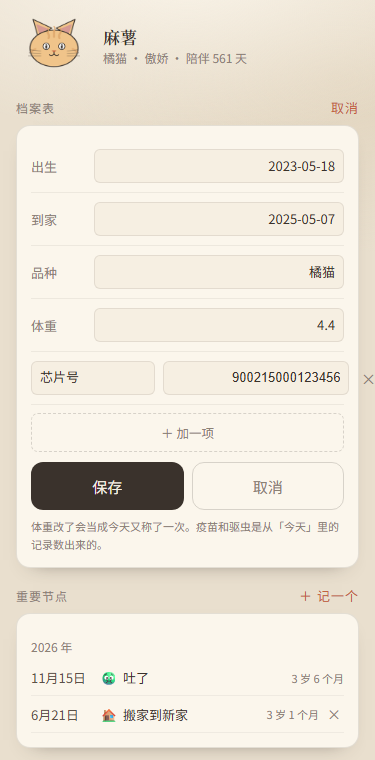

# 爪记一生 · 微信小程序版

> 已绑定的 AppID：`wx1d66ab65ccf9345b`（见 `project.config.json`）
> ⚠️ AppSecret 是密码，**不要提交到仓库**，也不要用它去换 access_token 做调试；这个项目不需要它。

小程序版走的是**宠物健康档案**这条路：平时最容易忘的事（上次什么时候驱虫、疫苗该不该打了），
打开就是一句话答案。日记那套情感功能还在，但退到后面。

数据层、文案生成、主题、按钮排序和浏览器版是**同一份代码**（`utils/` 下那四个文件是同步产物）。

## 怎么跑起来

1. 装 **微信开发者工具**（稳定版即可）
2. 「导入项目」→ 目录选这个 `mp/` 文件夹
3. AppID：
   - 只想看界面 → 点「测试号」
   - 要真机预览 / 用云开发 → 填自己的 AppID（`mp.weixin.qq.com` 里注册一个，个人主体就行）
4. 云开发（**想要「换手机记录还在」就必须开**）：
   - 开发者工具点左上「云开发」→ 开通 → 新建环境（按量付费，有免费额度）→ 复制**环境 ID**（形如 `itsworld-3gxxxxx`）
   - 打开 `app.js`，把第 9 行的 `var ENV_ID = '';` 换成你的环境 ID
   - 右键 `cloudfunctions/login` → 「上传并部署：云端安装依赖」
   - 云开发控制台 → 数据库 → 新建三个集合：`pets`、`days`、`records`，**权限都选「仅创建者可读写」**
   - 云开发控制台 → 存储 → 权限设置选「仅创建者可读写」
   - 填不填都能用：没填就是纯本地（换手机会丢），填了就自动登录并同步

打开就能用：没有宠物时先建档（名字 / 猫狗 / 品种 / 性格 / 生日），建完就是「该做」页。

## 里面有什么

四个 tab：

| 页面 | 内容 |
|---|---|
| **该做** | 一眼看到下次该干什么：「下次驱虫：11月27日」，已经过期就说「该体内驱虫了：11月1日」；每张卡带「晚了 N 天 / 还有 N 天」和提醒铃铛；随手记一笔（疫苗 / 驱虫 / 看病 / 体重）；最近 5 条；今年花了多少钱；它的日记一句话 |
| **记录** | 全部记录，按月分组，可按类型筛（疫苗 / 驱虫 / 看病 / 用药 / 体重 / 体检 / 手术 / 其他），每条带花费和附件数 |
| **病史** | 一次生病从头到尾：同名的看病 + 用药自动凑成一次，标「还没好 / 已好」，能看到天数、条数、花了多少钱，还能「标记已好」 |
| **它** | 资料修改、换主题（5 套）、按钮管理、导出备份、示例数据、重新开始 |

不占 tab 的页面：

- **记一次**：类型 / 日期 / 该类型专属字段 / 医院 / 花费 / 下次（自动算，可改）/ 附件 / 备注
- **日记、日记详情**：和浏览器版一致的日记列表与正文
- **档案（旧）**：老版本的档案页还留着，可以继续用

## 周期规则（自动算下次）

| 项目 | 狗 | 猫 | 说明 |
|---|---|---|---|
| 狂犬疫苗 | 12 个月 | 12 个月 | |
| 联苗 / 猫三联 | 12 个月 | 12 个月 | 第 1 针算 1 个月后 |
| 体内驱虫 | 3 个月 | 3 个月 | |
| 体外驱虫 | 1 个月 | 1 个月 | |
| 体检 | 12 个月 | 12 个月 | |

规则在 `utils/types.js` 的 `PT.REC_KINDS` 里（`cycle` / `cycleByRoute`），加鹦鹉、兔子就是往表里加一行。

## 记一次的附件

- **照片**：`wx.chooseMedia` 一次最多 9 张，压缩后上传
- **视频**：一次 1 条，最长 60 秒
- **文件**：`wx.chooseMessageFile`，化验单 PDF 这类，需要从聊天里选
- 开了云开发就传云存储（`media/` 下），没开就存在本地 `USER_DATA_PATH`
- 记录里只存 `fileID`，看的时候换临时地址

## 云开发：登录与同步是怎么做的

- **登录**：`wx.cloud.callFunction({name:'login'})` 拿 `openid`，它就是你的账号。换一台手机登同一个微信，openid 不变 → 数据自动回来。没有密码，也没有手机号（个人主体用不了 `wx.getPhoneNumber`）。
- **数据表**：`pets`（一只一条）、`days`（一天一条）、`records`（每条健康记录一条）。每条都带 `_openid`，加上「仅创建者可读写」，天然互相看不见。
- **照片视频**：`wx.cloud.uploadFile` 传到 `media/` 下，数据库里只存 `fileID`，看的时候用 `getTempFileURL` 换临时地址。免费 5GB，10 秒视频约 2～4MB。
- **什么时候同步**：进「该做」页先拉一次（云端更新就覆盖本地）；本地一有改动，1.2 秒后推一次。没网就只写本地，下次进来再对一遍。
- **没填环境 ID 时**：`cloud.enabled()` 返回 false，所有联网函数直接返回空，页面照常用本地存储。

## 头像：照片优先

「它」页点一下头像（右下角有相机小圆点）→ 从相册选一张 / 拍一张 → 存到本地
（`wx.getFileSystemManager().saveFile` 到 `USER_DATA_PATH`，重启还在）；档案页的头像也能点。



- 「换一张照片」重选，「用回画的」删掉照片回到插画
- 建档时也能直接选
- 没照片时用的是**和浏览器版同一套矢量画导出的 PNG**：`assets/faces/` 里 26 品种 × calm/happy 共 52 张，
  所以小程序里的头像和网页版长得一模一样

## 和浏览器版的差别（故意的简化）

| | 浏览器版 | 小程序版 |
|---|---|---|
| 健康档案 | 档案页可编辑 + 自定义字段 | 记录 / 病史 / 该做 三个页面，到期自动算 |
| 头像 | 手绘 SVG，26 品种 × 7 心情 | 预生成的 PNG（calm/happy）+ 可上传照片 |
| 照片视频 | IndexedDB 存原图 | 云存储（或本地），记一次里可以挂附件 |
| 分享图 | canvas 导出 PNG | 还没做（下一步用 `wx.createOffscreenCanvas`） |
| 拖动排序 | 指针拖拽 | `‹ ›` 按钮挪位 |
| 提醒 | 无 | 「提醒我」订阅消息（还没接） |

## 文件结构

```
mp/
├── app.js / app.json / app.wxss      # 全局：主题变量、卡片、按钮、chips 样式
├── project.config.json
├── cloudfunctions/login/             # 只返回 openid
├── components/face/                  # 拼出来的头像（properties: species/mood/breedId/size/photo）
├── utils/
│   ├── pt-core.js                    # 共享 PT 对象 + PT.STORAGE
│   ├── all.js                        # 一次装齐 types/writer/theme/store
│   ├── types.js writer.js theme.js store.js   # ← 从 ../src 同步，别直接改
│   ├── face.js                       # 品种 → 头像样式
│   ├── chips.js                      # 按钮列表的增删排序
│   ├── cloud.js                      # 登录 / 拉取 / 推送 / 上传
│   ├── photo.js                      # 选图 + 落盘
│   └── theme-style.js                # 主题 → 内联 style 串
└── pages/
    ├── home/        # 该做（首页）
    ├── records/     # 记录列表
    ├── history/     # 病史
    ├── record/      # 记一次
    ├── pet/         # 它
    ├── archive/     # 档案（旧）
    ├── today/ diary/ entry/   # 日记那条线（保留）
```

`utils/` 里那四个文件是同步产物，**要改去改 `../src/` 下的原件**，然后：

```bash
node tools/mp-sync.mjs     # 同步 + 把 window/localStorage 换成小程序写法
```

## 自检

```bash
node tools/mp-smoke.mjs    # 数据层 / 主题 / 按钮 / 档案 / 健康记录 / 云模块，60 项
node tools/wxml-check.mjs  # WXML 里绑定的变量、事件方法是否都存在
node tools/bom.mjs         # 查 BOM（PowerShell 写文件容易带）
```

## 上架前还要补的

- 订阅消息（疫苗/驱虫到期提醒，个人主体只能一次性订阅：用户点一次铃铛，到期推一条）
- 分享图（朋友圈/对话卡片）
- 隐私保护指引（用相册、相机的要声明）
- 内容安全（自定义性格/事件名是 UGC，接 `msgSecCheck`）
- ICP 备案（2023-09 起必须，管局 1–20 个工作日）

## 分享卡片

「该做」和「它」两页都支持右上角「转发」和「分享到朋友圈」。分享出去的不是一张截图，而是现画的一张卡片：

- 左边是它的头像（上传过照片就用照片，没传就用插画）
- 右边是名字、品种·年龄、「疫苗 · 驱虫 · 看病 · 体重」、「陪伴第 N 天」
- 底部一条「爪记一生 / 疫苗、驱虫、看病，一页记一辈子」

实现在 `utils/share.js`：用页面里那个隐藏的 `<canvas type="2d" id="shareCanvas">` 画 500×400 的图，`canvasToTempFilePath` 出临时文件，缓存按「宠物 id + 名字 + 照片」做 key。想改文案就改 `message()` / `timeline()` 里的 `title`。

## 订阅消息提醒（到期真的发微信通知）

个人主体只能用**一次性订阅**：用户点一次「允许」，我们只能发一条。所以流程是：

1. 用户在「该做」页点卡片右上角的铃铛 → 弹微信授权框；
2. 同意后，云端的 `subs` 集合里这条记录的 `remain` +1；
3. 云函数 `notify` 每天 9:00 跑一次，扫 `reminders` 集合里 3 天内到期的项，有额度就发一条，发完 `remain` -1。

**要你自己做三步**（我没法替你点后台）：

1. 后台「基础功能 → 订阅消息」→ 选一个「宠物提醒 / 待办提醒」类模板（字段要能对上 `thing1` 宠物名、`thing2` 事项、`date3` 日期），拿到模板 ID；
2. 把 ID 填进两个地方（**必须一致**）：
   - `mp/utils/notify.js` 顶部的 `TPL = { vaccine, deworm, visit }`
   - `mp/cloudfunctions/notify/index.js` 顶部的同名 `TPL`
3. 开发者工具里右键 `cloudfunctions/notify` → 「上传并部署（云端安装依赖）」。

没填模板 ID 时不会报错：铃铛照常记状态，只是不弹微信通知（会提示「已打开提醒（微信通知还没开通）」）。

集合由 `init` 云函数自动建：`pets / days / records / stories / reminders / subs`。
